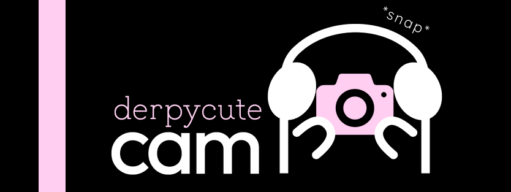

# derpycutecam



From the co-owners of derpycuteclub, a prototype mobile booth app designed for mobile setups. Modern day smartphones have powerful cameras comparable to DSLR cameras. By leveraging the power of a smartphone camera, small business owners can create and setup their own mobile booth setup with their smartphone and a dash of creativity.

## Features

- To be added...

## Get started

1. Install dependencies

   ```bash
   npm install
   ```

2. Start the app

   ```bash
   npx expo start
   ```

3. Start the print server
   ```bash
   cd print-server
   npm run docker:start
   ```

## Build configurations

- [Development build](https://docs.expo.dev/develop/development-builds/introduction/)
- [iOS simulator on Mac](https://docs.expo.dev/workflow/ios-simulator/)
- [Expo Go](https://expo.dev/go)

## Printing

Configure your printer on a local private network to own a static IP address.

Generate a printer api key

```bash
openssl rand -hex 32
```

Set these values in the app's root `.env` file, then restart Expo and reload the app:

```dotenv
EXPO_PUBLIC_PRINT_SERVER_URL=printer-static-ip-address
PRINTER_API_KEY=your-print-server-api-key
```
